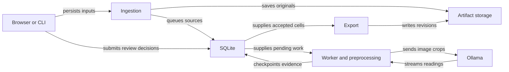

# Architecture

Pool Headcount separates short upload/review HTTP requests from long model calls. A durable SQLite queue and immutable artifacts let a worker resume unfinished work after a process or network interruption.

## Overview

The browser and CLI persist evidence before model processing begins. The worker reconciles successful readings with audited reviews before exporting workbooks.



## Components

### Web and CLI

`app/main.py`, `templates/`, and `static/` own HTTP routes, server-rendered views, corner selection, and polling. `app/cli.py` calls ingestion and services directly instead of making HTTP requests. `services.py` owns status, batch controls, versioned source configuration, and corrections. Neither entry point performs background inference by itself.

### Ingestion and preprocessing

`ingestion.py` validates ZIP paths, applies limits, decodes supported image formats, and deduplicates source hashes within a job. `storage.py` hashes artifacts and writes atomically. `preprocessing.py` detects grids, fits perspective transforms, identifies sections, and creates versioned rectified pages and crops.

### Worker and model boundary

`worker.py` owns the single-worker lock, database generation, heartbeat, task selection, retries, and recovery. `ollama_client.py` owns capability checks and bounded streamed HTTP calls. `prompts.py` supplies extraction instructions and `schemas.py` validates response structure. Database transactions do not span inference.

### Reconciliation and review

`count_text.py` normalizes count expressions. `reconciliation.py` compares A/B and cross-source observations, resolves copy-down, retains provenance, and protects reviewed cells. Human decisions advance the job revision and can regenerate an export without asking the model again.

### Workbook export

`layout.py` maps schedule slots and columns. `workbook.py` validates legacy OOXML (Office Open XML) inputs; `monthly_workbook.py` reads/writes the monthly layout. `exporting.py` snapshots revisions, checks immutable templates, uses per-job locks, and optionally verifies a separate LibreOffice result. The [fallback template provenance](https://github.com/willtheorangeguy/ucac-ocr/blob/HEAD/app/assets/README.md) records how the sanitized asset was prepared.

### Durable storage

`db.py` configures SQLite transactions and compatibility migrations. `migrations/001.sql` defines the base schema. One local data directory contains the database, locks, logs, and per-job artifacts. Stored paths are significant during restore.

## Data flow

1. Web or CLI stores the workbook/photo originals and records sources before returning the job identifier.
2. The worker turns each eligible source into versioned pages and crop tasks. Uncertain geometry requires a saved correction before inference.
3. Sequential Ollama calls commit complete validated readings together with attempt metadata. Raw streams remain evidence. Reconciliation combines observations in date/time order and raises issues for uncertainty.
4. Reviews change accepted cells and advance the revision. When work settles, export writes an immutable XLSX and import report. An edit during export leaves the older artifact tied to its snapshot revision and queues a newer one.

## Directory layout

```text
app/
├── main.py, cli.py, services.py    Entry points and operations
├── worker.py, ollama_client.py     Durable inference
├── ingestion.py, preprocessing.py Input and image geometry
├── schemas.py, reconciliation.py  Validation and review
├── workbook.py, monthly_workbook.py
├── db.py, migrations/             Durable records
├── assets/                       Sanitized monthly template
└── templates/, static/            Web UI
tests/                            Isolated regression suite and fixtures
validation/                       Historical reports and validation helpers
scripts/prepare_release.py        Version-pinned deployment assets
docs/                             Site source
mkdocs.yml                        Shared configuration inheritance and nav
```

## Storage and schema

`DATA_DIR/jobs.sqlite3` uses WAL, foreign keys, a 30-second busy timeout, and immediate write transactions. Schema version 1 is established by SQL; `migrate()` also handles additive compatibility changes and one-time legacy export regeneration. Web startup and the worker call migrations, so they must use the same data directory.

| Table | Purpose |
| --- | --- |
| `schema_version` | Base schema marker. |
| `jobs` | Month, mode, immutable template path/hash, state, revisions, diagnostic, and coverage acknowledgement. |
| `sources` | Original/normalized photo paths, hash, filename, assigned/observed dates, layout hint, geometry, and version. Unique photo hash per job. |
| `pages` | Versioned rectified sections, transforms, and image paths. |
| `tasks` | Unique task key, version, pass, crop, expected times, state, retry counters, and schedule. |
| `attempts` | Start/finish status, raw response path, profile/model metadata, error, and metrics. |
| `readings` | Validated per-task cell readings. |
| `cells` | Reconciled date/time/column values, kind, acceptance, provenance, and reviewed flag. |
| `issues` | Unique job issue key, details, source/cell association, and resolution status. |
| `decisions` | Audited review/control actions with reviewer, note, and time. |
| `exports` | Immutable revision path, checksum, draft flag, report, and recalculation metadata. |
| `worker_owner` | Single generation, heartbeat, active task, and cooldown record. |

Per-job subdirectories hold templates, originals, normalized images, rectified pages, crops, response streams, and exports. `worker.lock` and `worker.log` live at the data root; export locks are per job. Paths are stored in database records, so restoring to another absolute path requires explicit metadata migration. Artifacts are not automatically purged.

## State and recovery

Jobs move from `ingesting` to `queued`/`running` and eventually `completed` or `completed_with_issues`. `waiting_for_ollama` preserves outage diagnostics; permanent configuration errors pause the job. Export failures use `awaiting_review`. Manual `paused` and `cancelled` states stop dispatch after an active call and retain evidence. Reviews and added sources advance the revision and reopen eligible batches.

Tasks progress through `pending`, `in_flight`, and `succeeded`, or `retry_wait`/`failed`. Split retries supersede a parent and create smaller bands; disabled B tasks can be `skipped`. Sources can be `pending`, `processing`, `succeeded`, `needs_review`, `deferred`, or `failed` (invalid input). A deferred bad photo does not block later eligible work.

An OS file lock and database generation allow one worker to own a data directory. Startup marks abandoned attempts interrupted and retries unfinished tasks after cooldown. Completed readings and task responses are committed together; transactions never span inference requests. Streaming resumes by retrying the unfinished task, not by resuming a partial remote response.

Availability failures do not spend content-retry budgets. After five consecutive availability failures, short health probes gate retries. Content failures receive bounded retries and smaller bands/larger output budgets; resource failures get a smaller-context attempt before deferral. Permanent HTTP/model errors pause for operator action. A remote request may continue after local disconnect, so cooldown is part of recovery.

Exports snapshot a revision outside long-held database transactions and use an export lock. If a review advances the job while export runs, the old artifact remains tied to its original revision; a newer export can follow. See [deployment](./deployment.md) for backup/restore and [rules](./rules.md) for workbook semantics.
